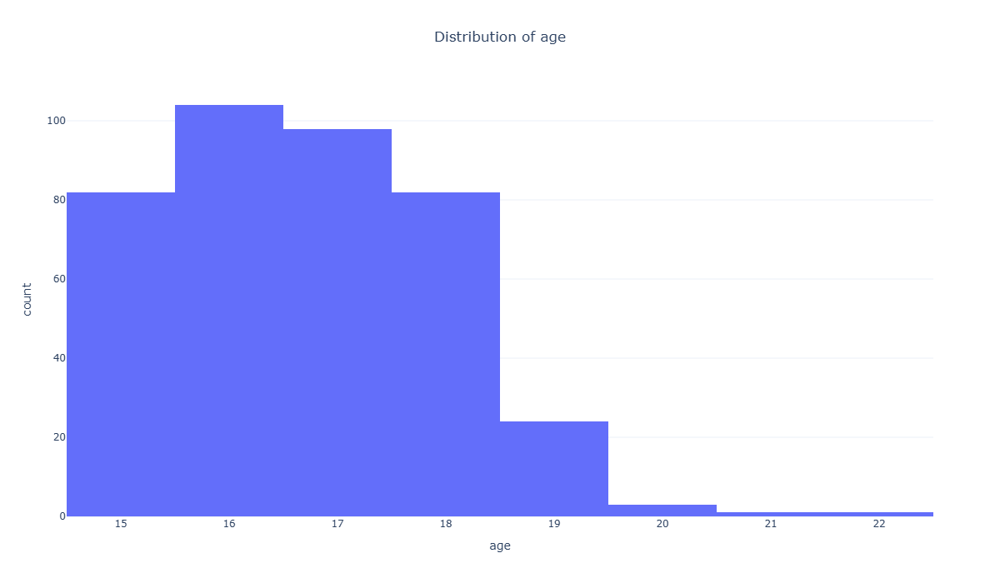

# AI Data Visualization Assistant

An AI-powered data visualization application that allows users to upload datasets and generate interactive charts using natural-language prompts.

## Project Overview

The **AI Data Visualization Assistant** simplifies data analysis by allowing users to interact with datasets without manually writing complex visualization code.

Users can upload CSV or JSON files, preview datasets, explore their schema, and request visualizations using simple natural-language instructions.

The application processes uploaded data using Pandas, interprets visualization requests, and generates interactive charts using Plotly.

## Application Screenshots

### 1. Homepage


### 2. Dataset Upload


### 3. Data Preview


### 4. Visualization Results


### 5. Interactive Charts


### 6. Additional Visualization


### 7. Application Output


### 8. Final Generated Visualization



## Key Features

- **Dataset Upload:** Upload CSV and JSON files.
- **Data Processing:** Read and process datasets using Pandas.
- **Data Validation:** Validate supported file formats.
- **Schema Extraction:** Display the number of rows, columns, column names, and data types.
- **Data Preview:** Preview the first five records of an uploaded dataset.
- **Natural Language Prompts:** Request charts using simple text instructions.
- **Prompt Processing:** Identify chart types, dataset columns, and aggregation operations.
- **Interactive Visualizations:** Generate interactive charts using Plotly.
- **Multiple Chart Types:** Support bar, line, scatter, pie, and histogram charts.
- **Chart Download:** Download generated visualizations as PNG images.

## Technologies Used

| Category | Technologies |
|---|---|
| Programming Language | Python |
| Backend Framework | FastAPI |
| Data Processing | Pandas, NumPy |
| Data Visualization | Plotly |
| Frontend | HTML, CSS, JavaScript, Bootstrap |
| Template Engine | Jinja2 |
| Server | Uvicorn |
| API Documentation | Swagger UI |

## System Architecture

The application follows a modular architecture.

1. **Frontend Layer:** Provides the user interface for dataset uploads and visualization requests.
2. **API Layer:** FastAPI handles upload and visualization requests.
3. **File Service:** Saves and reads CSV and JSON datasets.
4. **Schema Service:** Extracts dataset information and generates data previews.
5. **Parser Service:** Interprets natural-language prompts and identifies chart types, axes, and aggregation operations.
6. **Chart Service:** Generates interactive visualizations using Plotly.

## Project Structure

```text
AI-Data-Visualization-Assistant/
│
├── app.py
├── config.py
├── requirements.txt
│
├── routes/
│   ├── __init__.py
│   ├── upload.py
│   ├── schema.py
│   └── visualize.py
│
├── services/
│   ├── __init__.py
│   ├── file_service.py
│   ├── schema_service.py
│   ├── parser_service.py
│   └── chart_service.py
│
├── templates/
│   └── index.html
│
├── static/
│   ├── css/
│   │   └── style.css
│   └── js/
│       └── script.js
│
├── screenshots/
│   ├── Screenshot 2026-11-26 111313.png
│   ├── Screenshot 2026-11-26 111334.png
│   ├── Screenshot 2026-11-26 111413.png
│   ├── Screenshot 2026-11-26 111436.png
│   ├── Screenshot 2026-11-26 111522.png
│   ├── Screenshot 2026-11-26 111751.png
│   ├── Screenshot 2026-11-26 111839.png
│   └── final_output.png
│
├── .gitignore
└── README.md
```

## Installation and Setup

Follow these steps to run the project locally.

### 1. Clone the Repository

```bash
git clone https://github.com/abirami-developer/AI-Data-Visualization-Assistant.git
```

### 2. Navigate to the Project Directory

```bash
cd AI-Data-Visualization-Assistant
```

### 3. Create a Virtual Environment

```bash
python -m venv venv
```

### 4. Activate the Virtual Environment

For Windows:

```bash
venv\Scripts\activate
```

### 5. Install Dependencies

```bash
pip install -r requirements.txt
```

### 6. Run the Application

```bash
uvicorn app:app --reload
```

### 7. Open the Application

Open the following URL in your browser:

```text
http://127.0.0.1:8000
```

### API Documentation

FastAPI Swagger documentation:

```text
http://127.0.0.1:8000/docs
```

## Supported Visualizations

| Chart Type | Purpose |
|---|---|
| Bar Chart | Compare values across categories |
| Line Chart | Visualize trends |
| Scatter Plot | Explore relationships between variables |
| Pie Chart | Represent proportions |
| Histogram | Understand data distributions |

## Natural Language Prompt Examples

Users can enter instructions such as:

- Show a bar chart of Rating by Category.
- Generate a line chart of sales by month.
- Create a scatter plot of Price vs Rating.
- Show a pie chart of values by category.
- Display the distribution of Rating.
- Calculate the average Rating by Category.
- Show the total sales by region.

## Future Enhancements

- Advanced natural-language understanding.
- Improved prompt interpretation and column matching.
- Support for additional data formats.
- Advanced statistical analysis.
- More visualization options.
- Enhanced data security and validation.
- AI-powered analytical insights.

## Learning Outcomes

- Practical experience in Python application development.
- Understanding REST API development using FastAPI.
- Working with datasets using Pandas.
- Building interactive visualizations using Plotly.
- Integrating frontend and backend components.
- Developing modular and maintainable application architecture.

## Developed As

**Internship Project – Algorian Software Solutions**

**Project Title:** AI Data Visualization Assistant

**Developer:** Abirami Seenivasan

## GitHub Repository

[AI Data Visualization Assistant](https://github.com/abirami-developer/AI-Data-Visualization-Assistant)

---

*Developed as part of an internship project to simplify data exploration and visualization through natural-language interaction.*